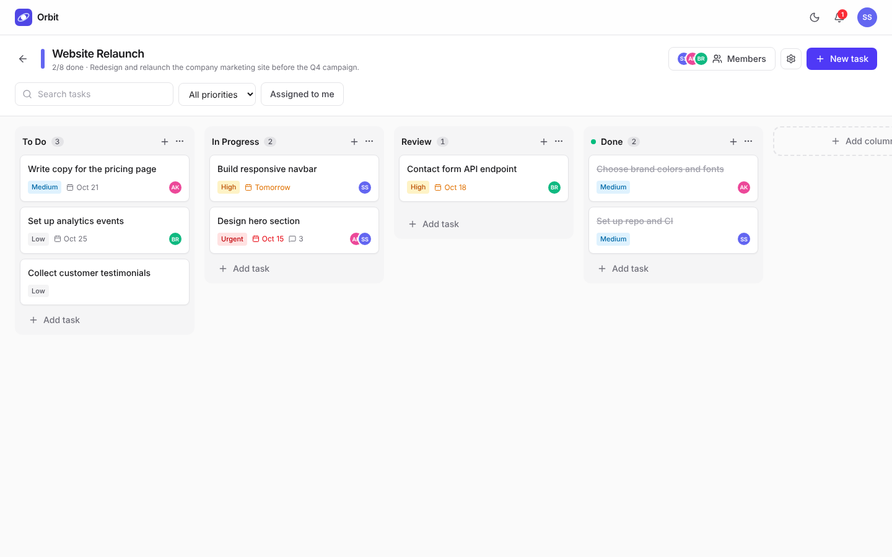
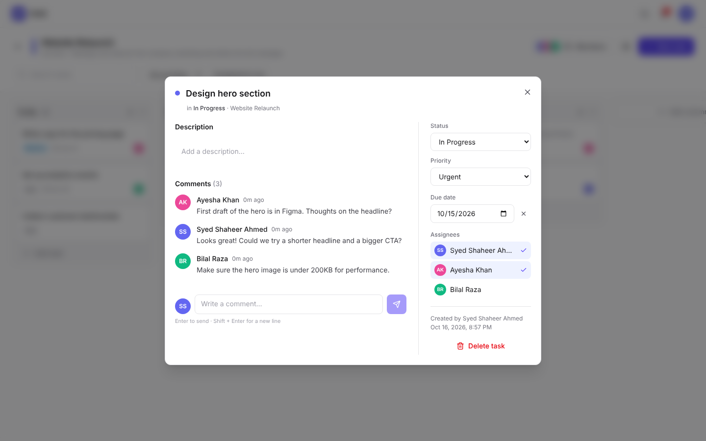
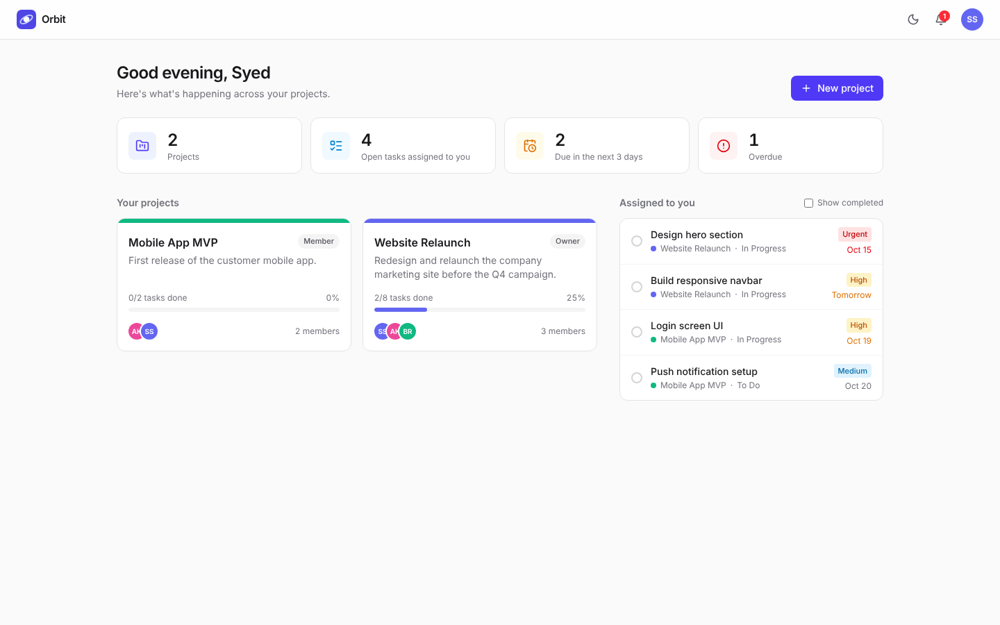
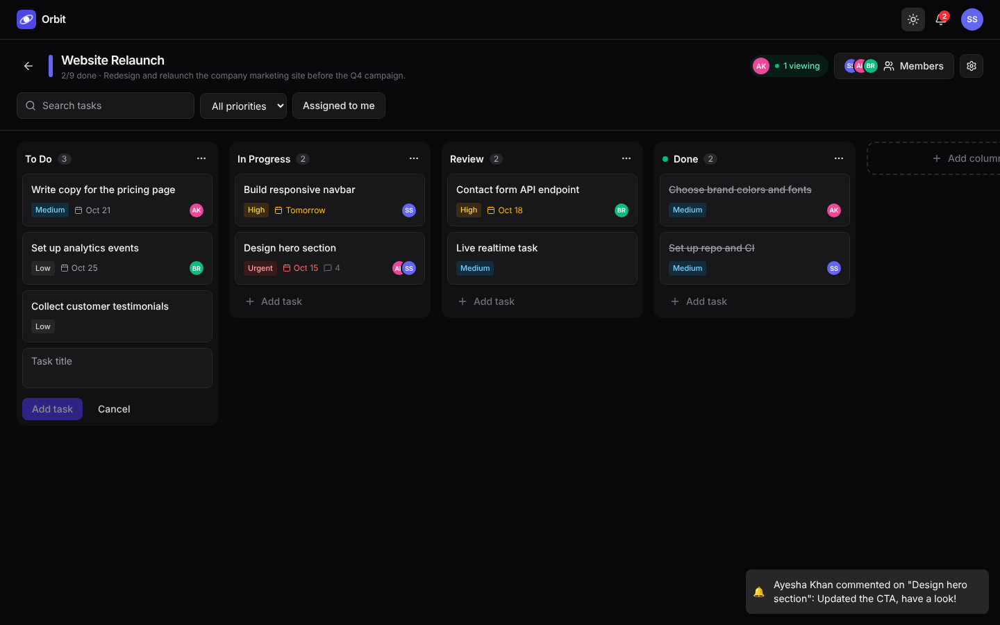
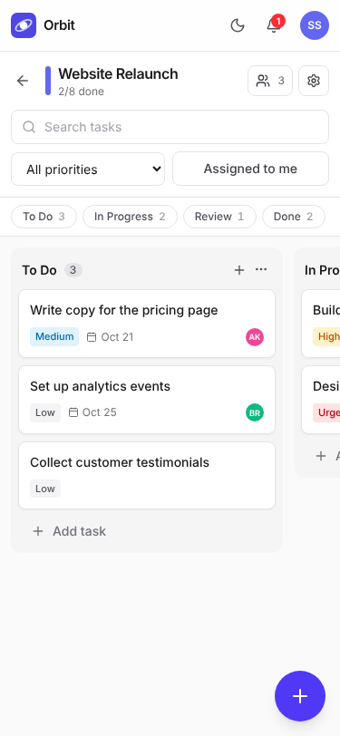
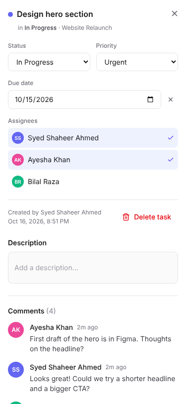
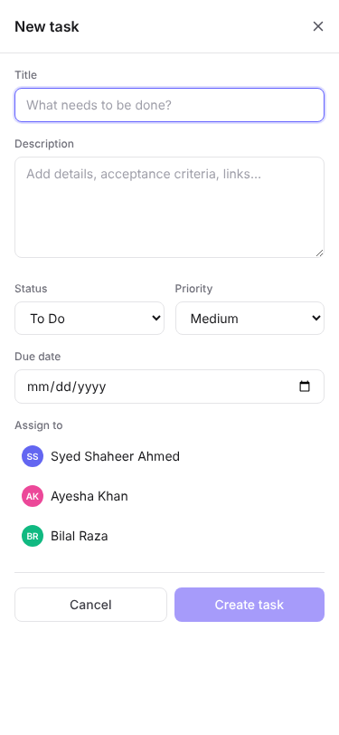

# Orbit — Project Management Tool


A collaborative project management tool in the spirit of Trello and Asana, built with the **MERN stack** and **Socket.io** for real-time collaboration. Create group projects, assign tasks on a drag-and-drop Kanban board, and discuss work in live comment threads.

Built by **Syed Shaheer Ahmed** for **CodeAlpha — Full Stack Development Internship, Task 3**.

**Live demo:** _coming soon_ · **Demo login:** `shaheer@demo.com` / `password123`

---

## CodeAlpha Task 3 requirements

| Requirement (from the task brief) | Where it's implemented |
|---|---|
| Build a collaborative tool similar to Trello or Asana | Kanban boards with columns and draggable task cards (`ProjectBoard`, `Column`, `TaskCard`) |
| **Create group projects** | "New project" form with optional teammate emails; invite more later from **Members**, with owner / admin / member roles (`POST /api/projects`, `POST /api/projects/:id/members`) |
| **Assign tasks** | Pick assignees in the **New task** form or in any task's details; assignees get an instant notification (`POST /api/projects/:id/tasks`, `PATCH /api/tasks/:id`) |
| **Comment and communicate within tasks** | Comment thread on every task, live for everyone on the board, with a "… is typing" indicator (`/api/tasks/:id/comments`, `comment:*` socket events) |
| Full stack with **auth system** | Register / login, JWT in an httpOnly cookie, bcrypt password hashing, protected routes and sockets |
| **Project boards, task cards** | Customizable columns (add / rename / delete), cards with priority, due date, assignees and comment count |
| **Backend to manage users, projects, tasks, comments** | Express 5 + MongoDB models: `User`, `Project`, `Task`, `Comment` (+ `Notification`), with membership and role checks on every route |
| **Bonus: notifications** | Persistent notifications with an unread bell and pop-up toasts for assignments, comments, moves and invites |
| **Bonus: real-time updates using WebSockets** | Socket.io rooms per project: tasks, moves, comments, members and columns sync instantly, plus who's-viewing presence |

## Features

**Core**
- Group projects with teammates invited by email, and owner / admin / member roles
- Kanban board with customizable columns
- Task cards with title, description, status, priority, due date and multiple assignees
- Full **New task** form, plus quick-add at the bottom of each column
- Comment threads inside tasks with a live typing indicator
- Secure auth: JWT httpOnly cookie, bcrypt, rate-limited login

**Real-time (Socket.io)**
- Live board sync: create, edit, move, delete, comments, column and member changes
- Live notifications with unread count and toast
- Presence: see who else is on the board

**Usability**
- In-app confirmation dialogs before anything is deleted (tasks, comments, columns, projects, members), with Cancel selected by default to prevent accidents
- Drag and drop between and within columns: mouse on desktop, press-and-hold on phones
- Dashboard with progress bars, an "Assigned to you" list and overdue / due-soon counts
- Search and filter by text, priority or "assigned to me"
- Dark / light mode
- Demo seed data and one-click demo login

**Responsive on every screen (tested at 320, 375, 414, 768, 1024, 1280, 1440 and 1920 px)**
- Phones: swipeable snap columns, a column-jump bar, a floating "+" button for new tasks, full-screen task details, bottom-sheet dialogs and touch-friendly buttons
- Tablets: compact header, wrapped filters, two-column dashboard
- Desktops: the board fills the screen and each column scrolls on its own
- No horizontal page overflow at any tested width

## Screenshots

| Board | Task with live comments |
|---|---|
|  |  |
| **Dashboard** | **Dark mode** |
|  |  |

**On a phone**

| Board | Task details | New task |
|---|---|---|
|  |  |  |

## Tech stack

| Layer | Tech |
|---|---|
| Frontend | React 19, Vite, React Router, Tailwind CSS v4, dnd-kit, Axios, Socket.io client, react-hot-toast, lucide-react |
| Backend | Node.js, Express 5, Socket.io |
| Database | MongoDB with Mongoose (aggregation pipeline for project stats) |
| Auth & security | JWT (httpOnly cookie), bcrypt, Helmet, CORS, express-rate-limit |

## Project structure

```
CodeAlpha_ProjectManagementTool/
├── server/
│   └── src/
│       ├── index.js              # Express app + HTTP server + Socket.io
│       ├── socket.js             # Socket auth (JWT cookie), project rooms, presence
│       ├── seed.js               # Demo data
│       ├── config/db.js
│       ├── models/               # User, Project (members + columns), Task, Comment, Notification
│       ├── middleware/           # auth (protect), access (membership + roles), error handler
│       ├── controllers/          # auth, project, task, comment, notification
│       ├── routes/
│       └── utils/                # token, realtime emit helpers, notify, HttpError
└── client/
    └── src/
        ├── context/              # Auth, Socket, Theme, Confirm (in-app dialogs)
        ├── pages/                # Login, Register, Dashboard, ProjectBoard
        ├── components/           # Column, TaskCard, TaskModal, CreateTaskModal, MembersModal, NotificationBell, ...
        └── lib/                  # api (axios), utils
```

## Getting started

**Prerequisites:** Node.js 20.19+ (22 or 24 LTS recommended) and a MongoDB database (MongoDB Atlas free tier or local MongoDB).

### 1. Backend

```bash
cd server
cp .env.example .env      # Windows: copy .env.example .env — then fill in MONGO_URI and JWT_SECRET
npm install
npm run seed              # optional: demo users, projects, tasks and comments
npm run dev               # http://localhost:5000
```

### 2. Frontend (in a second terminal)

```bash
cd client
npm install
npm run dev               # http://localhost:5173
```

In development, Vite proxies `/api` and `/socket.io` to `localhost:5000`, so no frontend env file is needed.

### Demo accounts (after `npm run seed`)

| Email | Password | Role in "Website Relaunch" |
|---|---|---|
| shaheer@demo.com | password123 | Owner |
| ayesha@demo.com | password123 | Admin |
| bilal@demo.com | password123 | Member |

To see real-time updates, open two different browsers (or one normal and one incognito window), log in as two users, and open the same project.

## Environment variables

**server/.env**

| Variable | Description |
|---|---|
| `PORT` | API port (default 5000) |
| `NODE_ENV` | `development` or `production` (production enables `Secure; SameSite=None` cookies) |
| `MONGO_URI` | MongoDB connection string |
| `JWT_SECRET` | Long random string used to sign tokens |
| `JWT_EXPIRES_IN` | Token lifetime (default `7d`) |
| `CLIENT_URL` | Frontend URL(s) allowed by CORS and Socket.io, comma-separated |

**client/.env** (production only)

| Variable | Description |
|---|---|
| `VITE_API_URL` | Deployed backend URL, e.g. `https://codealpha-pm-api.onrender.com` |

## API reference

All routes are under `/api`. Everything except register and login requires authentication.

**Auth**
| Method | Route | Description |
|---|---|---|
| POST | `/auth/register` | Create account (sets cookie) |
| POST | `/auth/login` | Log in (sets cookie) |
| POST | `/auth/logout` | Clear cookie |
| GET | `/auth/me` | Current user |

**Projects** (members only; ⚙ = owner/admin, 👑 = owner)
| Method | Route | Description |
|---|---|---|
| GET | `/projects` | My projects with task stats |
| POST | `/projects` | Create project (optional `memberEmails` to invite teammates) |
| GET | `/projects/:id` | Project with members and columns |
| PATCH | `/projects/:id` ⚙ | Update name, description, color |
| DELETE | `/projects/:id` 👑 | Delete project and everything in it |
| POST | `/projects/:id/members` ⚙ | Add member by email |
| PATCH | `/projects/:id/members/:userId` 👑 | Change role |
| DELETE | `/projects/:id/members/:userId` | Remove member (⚙) or leave (self) |
| POST | `/projects/:id/columns` ⚙ | Add column |
| PATCH | `/projects/:id/columns/:colId` ⚙ | Rename column |
| DELETE | `/projects/:id/columns/:colId` ⚙ | Delete empty column |

**Tasks and comments**
| Method | Route | Description |
|---|---|---|
| GET | `/projects/:id/tasks` | All tasks on a board |
| POST | `/projects/:id/tasks` | Create task |
| GET | `/tasks/mine` | Tasks assigned to me across projects |
| PATCH | `/tasks/:taskId` | Update title, description, priority, due date, assignees |
| PATCH | `/tasks/:taskId/move` | Move to `{ column, index }` (drag and drop) |
| DELETE | `/tasks/:taskId` | Delete (creator or ⚙) |
| GET | `/tasks/:taskId/comments` | List comments |
| POST | `/tasks/:taskId/comments` | Add comment |
| DELETE | `/comments/:commentId` | Delete (author or ⚙) |

**Notifications**
| Method | Route | Description |
|---|---|---|
| GET | `/notifications` | Latest 30 and unread count |
| PATCH | `/notifications/:id/read` | Mark one read |
| PATCH | `/notifications/read-all` | Mark all read |
| DELETE | `/notifications` | Clear all |

## Real-time events (Socket.io)

The socket authenticates with the same httpOnly JWT cookie as the REST API. Each user joins a personal room (`user:<id>`) for notifications, and the board joins a project room (`project:<id>`) after a membership check. The client sends its socket id in an `x-socket-id` header, so the user who made a change isn't sent a duplicate event.

| Event | Room | Payload |
|---|---|---|
| `task:created` / `task:updated` | project | `{ task }` |
| `task:deleted` | project | `{ taskId }` |
| `tasks:moved` | project | `{ updates: [{ _id, column, order }] }` |
| `comment:created` / `comment:deleted` | project | comment, task id and new comment count |
| `project:updated` / `project:deleted` | project | `{ project }` / `{ projectId, name }` |
| `comment:typing` | project | `{ taskId, user, typing }` (client → server → teammates) |
| `presence` | project | `{ projectId, users }` |
| `notification:new` | user | populated notification |
| `project:added` / `project:removed` | user | `{ projectId }` |

## Deployment

WebSockets need a long-running server, so the **API goes on Render** (or Railway) and the **client on Vercel**. Vercel serverless functions can't hold Socket.io connections.

**Backend on Render**
1. New → Web Service → connect this repo, root directory `server`, build `npm install`, start `npm start`. A `render.yaml` blueprint is included.
2. Set `NODE_ENV=production`, `MONGO_URI`, `JWT_SECRET`, and `CLIENT_URL=https://your-app.vercel.app`.
3. In MongoDB Atlas → Network Access, allow `0.0.0.0/0` (Render IPs aren't fixed).

**Frontend on Vercel**
1. Import the repo, set root directory `client` (framework preset: Vite).
2. Add `VITE_API_URL=https://your-api.onrender.com`.
3. `client/vercel.json` already rewrites routes to `index.html` for client-side routing.

Because the client and API are on different domains, the auth cookie is sent with `SameSite=None; Secure` in production. Render's free tier sleeps after inactivity, so the first request can take ~30 seconds. Open the API URL once before recording a demo.

## Author

**Syed Shaheer Ahmed** · [LinkedIn](https://www.linkedin.com/in/syed-shaheer-ahmed-505a64332/) · [GitHub](https://github.com/devshaheerx)

CodeAlpha Full Stack Development Internship (Task 3: Project Management Tool)
